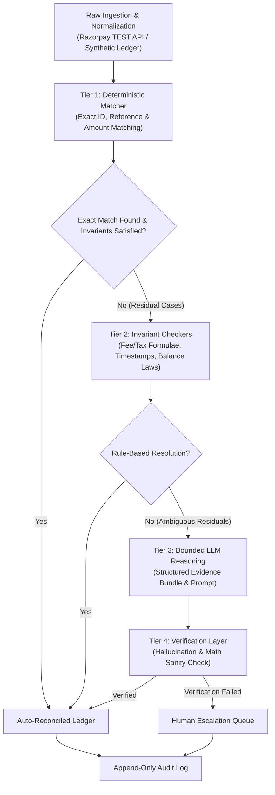

# recon-agent

An LLM-assisted payment reconciliation system for Razorpay TEST-mode data, designed with an explicit verification layer around all language model reasoning.

---

## 1. Problem Statement

Payment reconciliation, settlement accounting, and cash-flow forecasting in modern commerce remain largely manual, brittle, and operationally expensive. Finance teams spend hours resolving mismatches across gateway reports, bank statements, internal order ledgers, and fee schedules.

While modern Large Language Models (LLMs) demonstrate strong qualitative reasoning and pattern synthesis, unconstrained generation is dangerous in financial operations. In financial reconciliation, **verification—not generation—is the primary bottleneck**. A system cannot simply generate plausible reconciliation narratives; every assertion, calculation, and exception classification must be rigorously validated against mathematical invariants, ground-truth transaction logs, and immutable audit trails before acceptance.

---

## 2. What This Is and Is NOT

### What This Is
- A controlled 14-day engineering project building a resilient, verified reconciliation pipeline.
- Designed specifically for **Razorpay TEST-mode data** [DOCS: https://razorpay.com/docs/api/].
- A deterministic-first architecture where symbolic rules handle standard matching, and LLMs are constrained strictly to residual ambiguity.
- A multi-tier evaluation system benchmarking raw rules, unverified LLM generation, and verified LLM pipelines.

### Non-Goals (What This Is NOT)
- **NO write actions:** The system operates strictly read-only (HTTP GET only). It will never initiate payouts, refunds, settlements, or transfers.
- **NO real merchant data:** Operates exclusively on synthetic scenarios and Razorpay test-mode API keys.
- **NO production-readiness claims:** This is an experimental prototype and evaluation testbed, not a production financial accounting system.

---

## 3. Architecture

Reconciliation follows a strict waterfall pipeline:

1. **Ingest:** Fetches and standardizes records from gateway and internal ledger.
2. **Deterministic Matcher:** High-precision rule-based matching on exact IDs (`pay_...`, `order_...`), timestamps, and integer paise amounts.
3. **Invariant Checks:** Evaluates hard accounting constraints (e.g., $\text{credit} - \text{debit} - \text{fee} - \text{tax} = \text{net}$).
4. **LLM Residual Handler:** LLM is invoked **only** for residual ambiguous cases (e.g., partial refund timing mismatches, fee tier discrepancies).
5. **Verification Layer:** Independent algorithmic validator that checks:
   - Does the LLM cite valid row IDs present in the input case bundle?
   - Can every arithmetic number in the output be independently recomputed from cited rows?
   - Do proposed status changes violate accounting conservation laws?
6. **Human Queue & Audit Log:** Any output failing verification is escalated to a human queue. All actions are logged to an append-only audit trail.

---

## 4. Metric Definitions and Exact Mathematical Formulas

All monetary amounts are strictly evaluated in **integer minor units (paise)**. Floating-point arithmetic for currency is strictly prohibited across the codebase.

### 1. Per-Class Precision and Recall of Exception Detection
For each exception class $c \in C$ (e.g., missing settlement, unexpected fee deduction, duplicate payment, partial refund mismatch):

$$\text{Precision}_c = \frac{TP_c}{TP_c + FP_c}, \quad \text{Recall}_c = \frac{TP_c}{TP_c + FN_c}$$

Where:
- $TP_c$ = True positives for exception class $c$.
- $FP_c$ = False positives for exception class $c$.
- $FN_c$ = False negatives for exception class $c$.

### 2. False-Match Rate (FMR)
The proportion of matched transaction pairs that are incorrect:

$$\text{FMR} = \frac{\text{Incorrect Matches Made}}{\text{Total Matches Made}}$$

### 3. False-Positive Rate on Hard Negatives ($\text{FPR}_{\text{hard}}$)
Evaluated on benign anomalies (e.g., standard settlement delays over bank holidays, multi-currency fee roundings) that must NOT be flagged as exceptions:

$$\text{FPR}_{\text{hard}} = \frac{\text{Benign Anomalies Incorrectly Flagged as Exceptions}}{\text{Total Benign Hard Negatives Evaluated}}$$

### 4. LLM-Free Resolution Share
The fraction of reconciliation cases resolved deterministically without invoking an LLM:

$$\text{LLM-Free Resolution Share} = \frac{N_{\text{deterministic\_resolved}}}{N_{\text{total\_cases}}}$$

### 5. Hallucination Rate
The proportion of LLM responses that cite fabricated entities or non-recomputable figures:

$$\text{Hallucination Rate} = \frac{N_{\text{invalid\_row\_id\_or\_unrecomputable\_math}}}{N_{\text{total\_llm\_explanations}}}$$

An explanation is counted as hallucinated if:
1. It cites a transaction or entity ID not present in the input context bundle.
2. It states a monetary amount or fee that cannot be recomputed from cited input rows.

### 6. Verifier Block Rate
The sensitivity of the verification layer at intercepting flawed LLM outputs:

$$\text{Verifier Block Rate} = \frac{N_{\text{bad\_llm\_outputs\_blocked}}}{N_{\text{total\_bad\_llm\_outputs}}}$$

### 7. Accuracy vs. Coverage
Evaluates the trade-off between automated confidence and human escalation:

$$\text{Accuracy}_{\text{auto}} = \frac{N_{\text{correct\_auto\_resolved}}}{N_{\text{auto\_resolved}}}$$

$$\text{Human Queue Share} = \frac{N_{\text{escalated\_to\_human}}}{N_{\text{total\_cases}}}$$

### 8. Injection Tests Passed ($k/n$)
The count and ratio of known synthetic anomalies successfully detected:

$$\text{Injection Success} = \frac{k}{n} \quad (\text{e.g., } 48/50 \text{ injected fee discrepancies detected})$$

### 9. Cost and Latency per 1,000 Transactions
- **Latency:** Median ($p50$) and 95th percentile ($p95$) wall-clock seconds per 1,000 transactions.
- **Cost:** Total API expense (USD / INR) per 1,000 processed transactions.

### 10. Run-to-Run Agreement Across 3 Reruns
Measures classification consistency across 3 repeated runs on identical data at temperature 0:

$$\text{Agreement} = \frac{N_{\text{identical\_across\_all\_3\_runs}}}{N_{\text{total\_evaluated}}}$$

---

## 5. Honest Limitations Stub

> **Methodological Note:** Synthetic errors are self-labeled. Therefore, measured recall is inherently evaluated against our own injected error distributions and may overestimate performance against unforeseen external real-world edge cases. Field validation against external audit datasets remains a future milestone.

