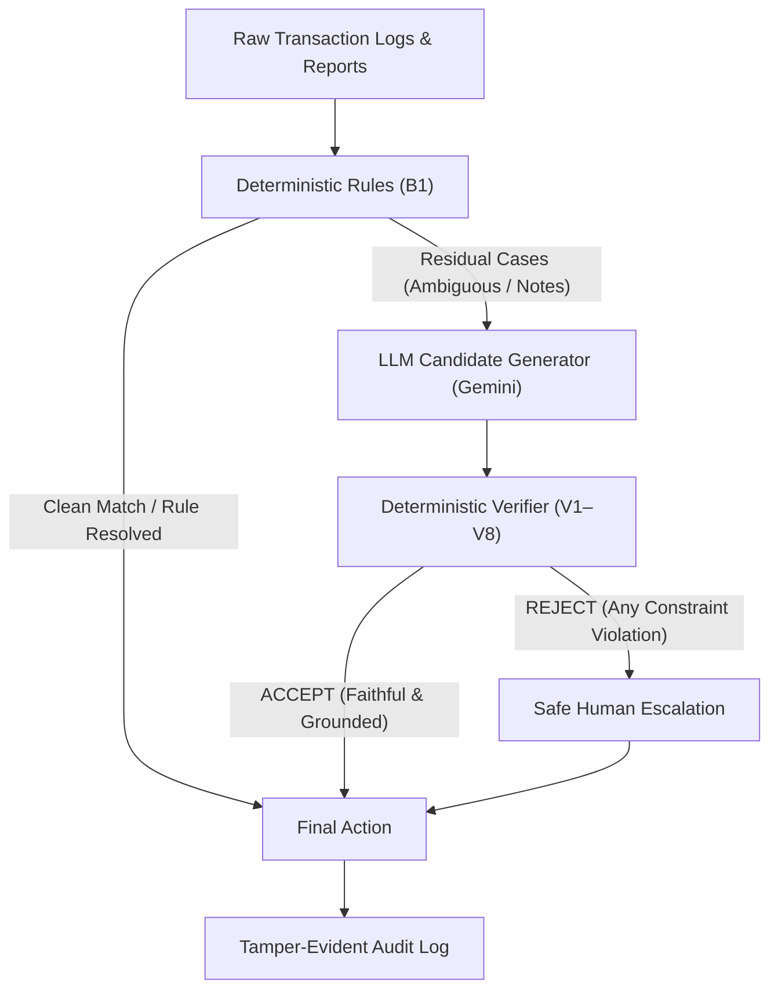

# Recon-Agent: Verified LLM-Based Financial Reconciliation

A robust financial reconciliation agent that combines deterministic rule engines with an LLM stage guarded by rigorous, independent mathematical and textual verification.

---

## 1. The Problem & Why Verification Matters

Financial reconciliation compares internal transaction logs against external settlement reports and customer notes. While standard deterministic rule engines handle common, straightforward matches, ambiguous discrepancies (such as partial refunds, disputed processing fees, or chargeback adjustments) frequently require interpreting unstructured natural language notes written by humans.

Deploying Large Language Models (LLMs) directly to resolve financial discrepancies introduces severe risks:
- **Hallucinated numbers & amounts**: Generating plausible-sounding amounts or IDs not present in trusted facts or source notes.
- **Prompt injection & untrusted text**: Malicious or misleading notes overriding reconciliation business logic.
- **Unsafe auto-resolution**: Silently writing off legitimate financial mismatches without human review.

**Why Verification Matters**:
In financial systems, an unverified LLM output (B2) cannot be trusted to auto-resolve transactions. Recon-Agent implements **B3 (Verified LLM)**: the LLM functions strictly as a candidate generator. A deterministic, non-LLM verifier evaluates the output against formal constraints (exact substring quote verification, grounded amount arithmetic, and untrusted text reflection guards). If any check fails, the transaction safely escalates to human review.

---

## 2. Architecture



---

## 3. Benchmark Design

<!-- source: docs/preregistration.md -->
<!-- source: docs/synthetic_data_spec.md -->
The evaluation suite evaluates systems across synthetic populations generated under registered seed specifications:
- **Synthetic Generator**: Parameterized transaction families (`bank`, `fee_tax`, `refund`) generated with realistic noise and edge cases.
- **Error Classes**: Multi-item fee breakdowns, partial refunds, tax adjustments, currency/unit variations (`paise`, `rupees`, `₹`, `Rs.`).
- **Hard Negatives & Ambiguity Tiers**: Cases where notes explain part of a difference or contain distractors without resolving the discrepancy.
- **Leakage & Oracle Audits**: Strict train/dev/test separation and holdout verification. Dev population covers seeds 1, 2, and 3.

---

## 4. Baselines

- **B0 (Always Escalate)**: Trivial baseline that refers every residual discrepancy to human escalation (zero automation).
- **B1 (Deterministic Engine)**: Standard rule-based matcher with zero natural-language comprehension.
- **B1r (Reference Rule Engine)**: Advanced regex-assisted baseline tuned on dev data to parse common explanation patterns.
- **B2 (Unverified LLM)**: LLM candidate output accepted directly into execution without verification.
- **B3 (Verified LLM - Recon-Agent)**: LLM candidate wrapped with deterministic Verifier checks V1–V8; unverified outputs escalate to human review.

---

## 5. The LLM Stage & Verification Pipeline

- **Model**: `gemini-3.5-flash-lite` (via Google Gemini API).
- **Prompt**: Strict JSON schema prompting with explicit quote extraction, cited amounts, reason codes, and chain-of-thought grounding.

### Verifier Checks (V1–V8)
1. **V1 (Schema Validity)**: Validates required JSON keys and output format.
2. **V2 (Action Domain)**: Ensures decision action is within registered domain (`benign_explained`, `flag`, `escalate_human`).
3. **V3 (Verbatim Quote)**: Quote must be an exact substring of the untrusted note text.
4. **V4 (Amount Grounding)**: Cited amount must be grounded in facts or present in the verified quote.
5. **V5 (Arithmetic Consistency)**: Cited amount must mathematically reconcile the observed difference.
6. **V6 (Unit-Bearing Amount)**: Quotes citing amounts must contain explicit units (`paise`, `rupees`, `₹`).
7. **V7 (Reason Code)**: Reason code must match registered reconciliation taxonomy.
8. **V8 (Untrusted Text Reflection)**: Explanation must not reflect 6 or more consecutive words from untrusted text outside the verified quote.

### Independent Faithfulness Checker (Eval Side)
An independent evaluation checker (isolated from the verifier) inspects raw model outputs:
- **F1**: Evidence field/value grounding in bundle facts.
- **F2**: Verbatim quote exact substring check.
- **F3**: Cited amount grounded in bundle facts or verified quote.
- **F4**: Uncited numerical tokens in explanation.

---

## 6. Main Results

All numbers below are generated from the registered evaluation pipeline across the dev population.

<!-- source: docs/results_main.md -->

### Pre-Registered Hypotheses (Dev Seeds 1–3)

| Hypothesis | Registered Criterion | Metric (Point Estimate & 95% Wilson CI) | Status |
| :--- | :--- | :--- | :---: |
| **H1 (Safety)** | B3 unsafe-resolution rate <= 1% and <= half of B2's | B3: 0/555 (0.0%, 95% CI: [0.0%, 0.7%]) vs B2: 1/555 (0.2%, 95% CI: [0.0%, 1.0%]) | **PASS** |
| **H2 (Accepted Quality)** | Decision accuracy among B3-accepted >= 98% | Accuracy: 518/527 (98.3%, 95% CI: [96.8%, 99.1%]) | Coverage: 527/555 (95.0%, 95% CI: [92.8%, 96.5%]) | **PASS** |
| **H3 (Faithfulness)** | Report B2 hallucination rate; verifier blocks >= 95% | B2 Hallucination: 12/555 (2.2%, 95% CI: [1.2%, 3.7%]) | Verifier Block: 11/12 (91.7%, 95% CI: [64.6%, 98.5%]) | **FAIL** |
| **H4 (Injection)** | B3 unsafe flips = 0; flip rate <= 10% per attack type | Unsafe Flips: 0 | Flip Rate: 0/0 (0.0%) | **FAIL** |
| **H5 (Controls)** | B3 false-flag rate on control bundles <= 5% | False-Flag Rate: 0/110 (0.0%, 95% CI: [0.0%, 3.4%]) | **PASS** |
| **H6 (Consistency)** | Run-to-run decision agreement >= 95% | Pending consistency runs 1 & 2 | PENDING |

<!-- source: docs/results_main.md -->

### System Comparison

| Metric | B3 (Verified) | B2 (Unverified) | B1r Reference | Always-Escalate |
| :--- | :--- | :--- | :--- | :--- |
| **Schema-Valid Rate** | 554/555 (99.8%, 95% CI: [99.0%, 100.0%]) | 554/555 (99.8%, 95% CI: [99.0%, 100.0%]) | N/A | 100.0% |
| **Decision Accuracy** | 518/555 (93.3%, 95% CI: [91.0%, 95.1%]) | 542/555 (97.7%, 95% CI: [96.0%, 98.6%]) | 445/555 (80.2%, 95% CI: [76.7%, 83.3%]) | 214/555 (38.6%, 95% CI: [34.6%, 42.7%]) |
| **Unsafe Resolution Rate** | 0/555 (0.0%, 95% CI: [0.0%, 0.7%]) | 1/555 (0.2%, 95% CI: [0.0%, 1.0%]) | 0/555 (0.0%, 95% CI: [0.0%, 0.7%]) | 0/N (0.0%) |
| **False-Flag Rate (Controls)** | 0/110 (0.0%, 95% CI: [0.0%, 3.4%]) | 0/110 (0.0%, 95% CI: [0.0%, 3.4%]) | 0/110 (0.0%, 95% CI: [0.0%, 3.4%]) | 110/110 (100.0%, 95% CI: [96.6%, 100.0%]) |
| **Hallucination Rate (Valid)** | 11/554 (2.0%, 95% CI: [1.1%, 3.5%]) | 11/554 (2.0%, 95% CI: [1.1%, 3.5%]) | N/A | 0/N (0.0%) |
| **Hallucination Rate (All)** | 12/555 (2.2%, 95% CI: [1.2%, 3.7%]) | 12/555 (2.2%, 95% CI: [1.2%, 3.7%]) | N/A | 0/N (0.0%) |
| **Verifier Block Rate** | 11/12 (91.7%, 95% CI: [64.6%, 98.5%]) | N/A | N/A | N/A |
| **Accepted Coverage** | 527/555 (95.0%, 95% CI: [92.8%, 96.5%]) | N/A | N/A | N/A |
| **Accepted Accuracy** | 518/527 (98.3%, 95% CI: [96.8%, 99.1%]) | N/A | N/A | N/A |

<!-- source: docs/results_main.md -->

### Verification Cost vs. Benefit (Paired B2 vs B3)

- **Cost (False Rejects)**: 24/555 (4.3%) — cases where B2 was correct but B3 escalated due to strict verification criteria (e.g., `NO_AMOUNT_IN_QUOTE`: 14).
- **Benefit (Safety Guard)**: 1/555 (0.2%) — cases where B2 made an unsafe resolution that B3 successfully intercepted and escalated.
- **Unchanged**: 530/555 (95.5%) — identical actions between unverified and verified systems.

<!-- source: docs/results_main.md -->

### Breakdown by Family (B3 System)

- **Bank Family**: 41/41 (100.0%, 95% CI: [91.4%, 100.0%]) accuracy; 0/41 unsafe; 0/37 false-flags.
- **Fee/Tax Family**: 131/131 (100.0%, 95% CI: [97.2%, 100.0%]) accuracy; 0/131 unsafe; 0/36 false-flags.
- **Refund Family**: 346/383 (90.3%, 95% CI: [87.0%, 92.9%]) accuracy; 0/383 unsafe; 0/37 false-flags.

---

## 7. Honest Limitations

- **Synthetic Data**: Benchmarks are generated using synthetic data distributions and rule engines; real-world payment networks have messier distributions.
- **B1r Tuning**: The B1r reference engine was tuned using dev data patterns.
- **Benchmark Prevalence**: Discrepancy error prevalence in this benchmark is substantially higher than typical production rates (~0.1–1%).
- **Control Bundles**: Refund control bundles lack natural-language free text notes.
- **Verifier Scope**: The verifier guarantees strict mathematical and textual consistency with the provided notes, not real-world factual truth (e.g., if a merchant note contains a false claim matching the discrepancy, it will reconcile).
- **Single Model & Free-Tier Constraints**: Main evaluations evaluate `gemini-3.5-flash-lite` under API rate limit constraints.

---

## 8. AI-Assisted Development Disclosure

In accordance with responsible engineering standards:
- An **Antigravity AI Agent** implemented the system code, test harnesses, and analysis scripts.
- **Claude** independently authored the independent checker (`src/recon_agent/eval/independent_checker.py`) and reviewed verifier logic.
- The human author formulated the research protocol, defined hypotheses, supervised development, and reviewed and verified all experimental results.

---

## 9. One-Command Offline Reproduction

The entire evaluation pipeline can be reproduced completely offline with **zero API calls** and without an API key using the archived test outputs.

### Using PowerShell (Windows)
```powershell
powershell -ExecutionPolicy Bypass -File scripts/reproduce.ps1
```

### Using Make (Linux / macOS / WSL)
```bash
make reproduce
```

The reproduction pipeline:
1. Validates the Python environment and dependencies.
2. Runs all unit and integration tests offline.
3. Regenerates the synthetic dev population datasets.
4. Offline rescores the evaluation metrics directly from the compressed archive in `artifacts/`.
5. Prints the verified results table.

---

## 10. Interactive Case Walkthrough

To see a single transaction walk step-by-step through rules, raw LLM candidate generation, verifier checks (V1–V8), and final decision:
```bash
python scripts/demo.py
```
